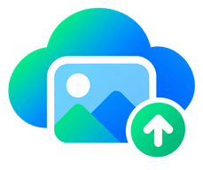
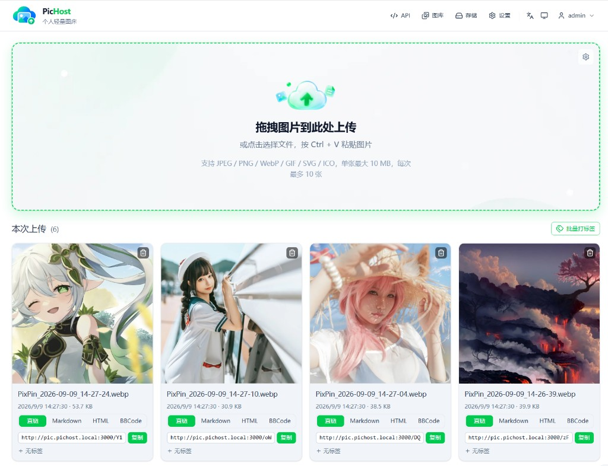
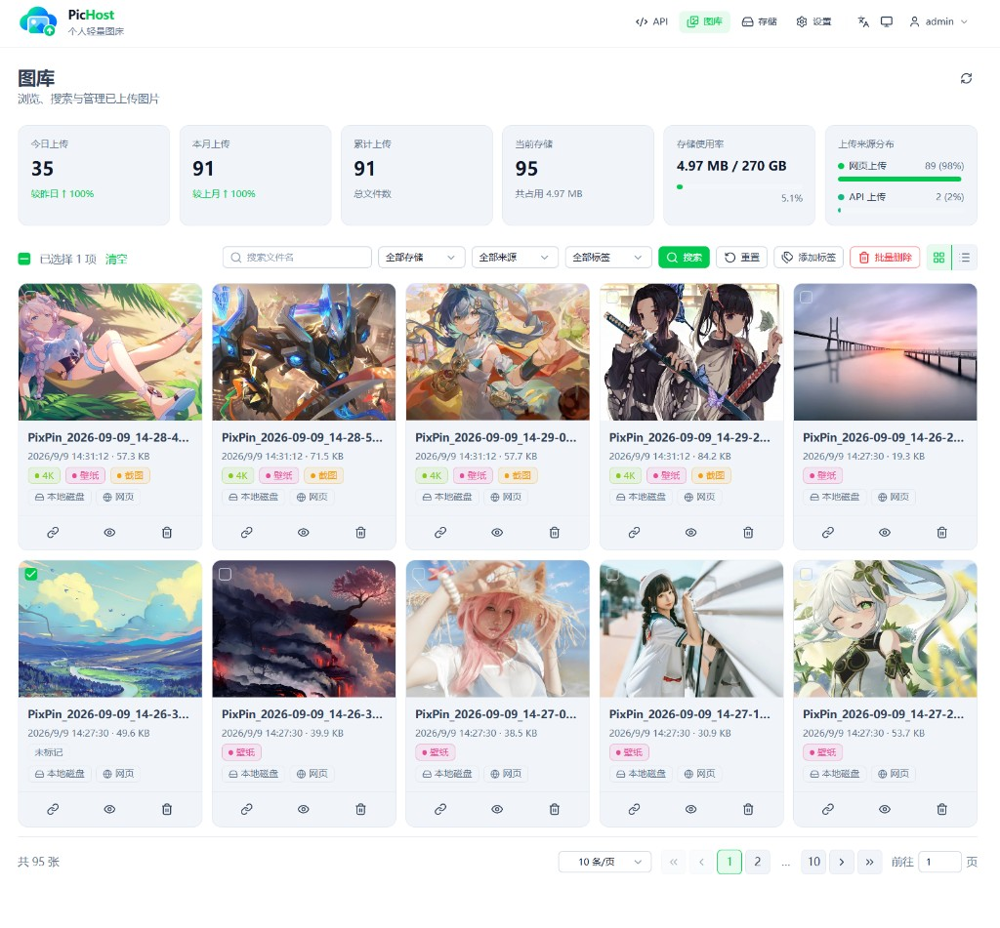
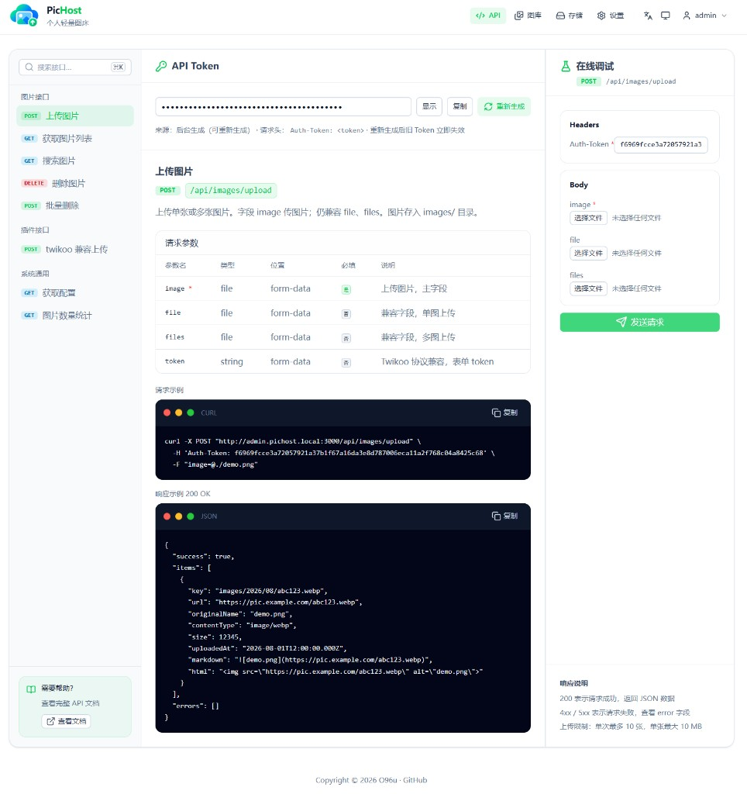
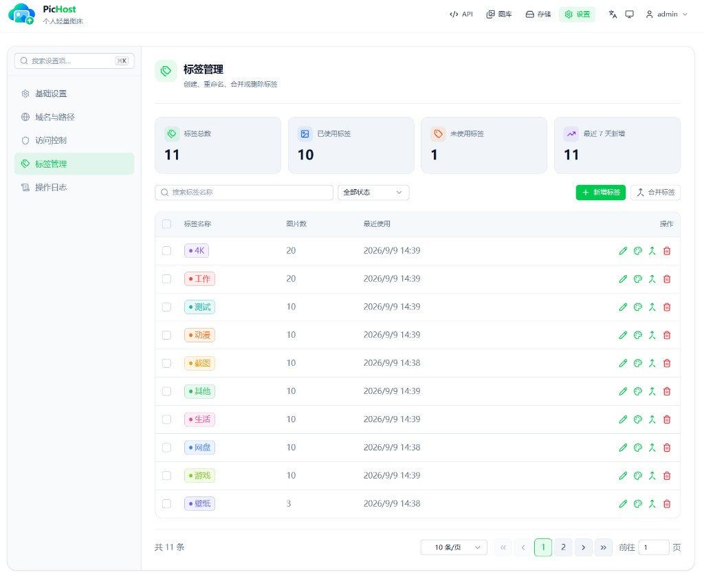
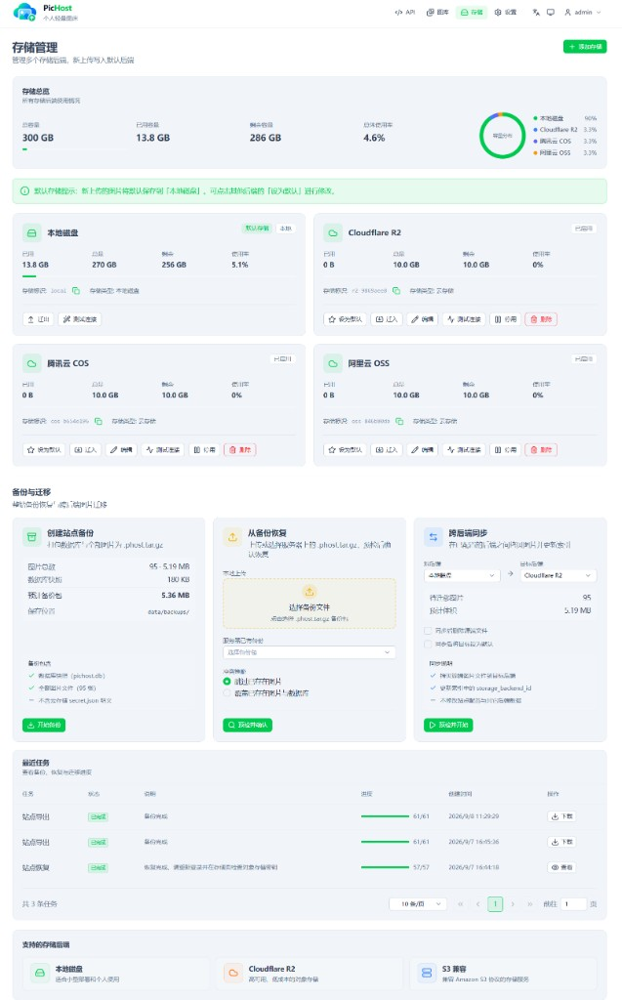
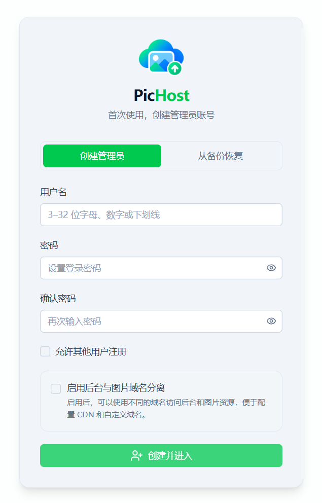
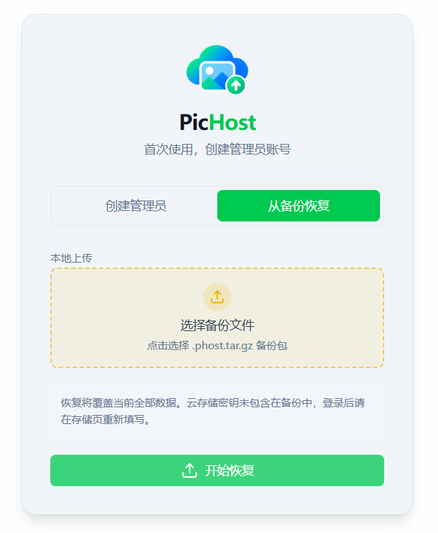
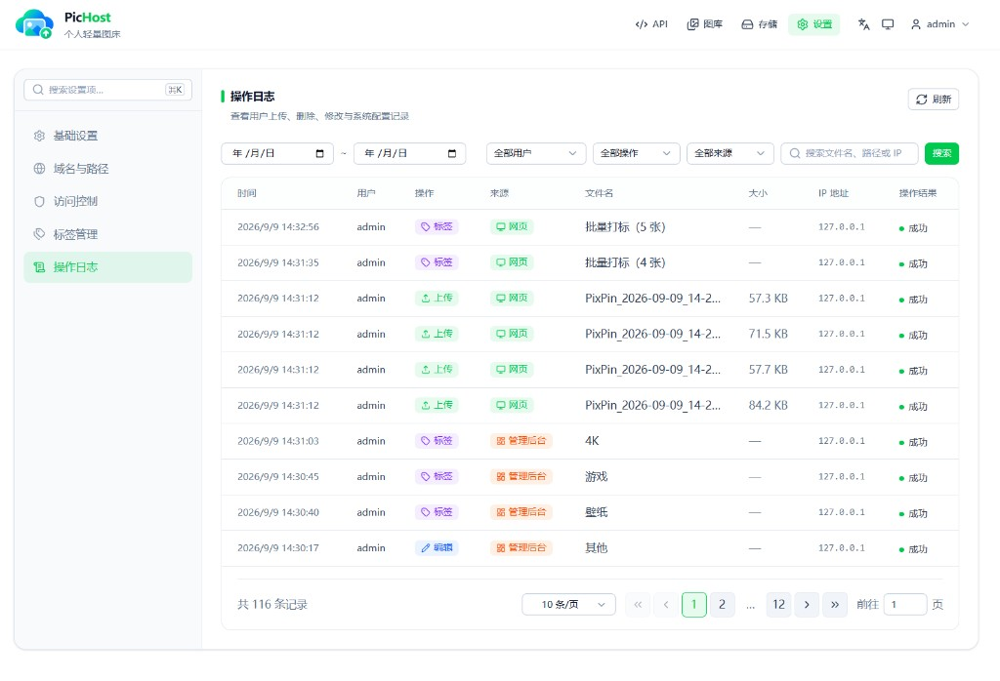

<p align="center">
  
</p>

<h1 align="center">PicHost</h1>

<p align="center"><strong>Self-hosted image, video, and file management platform</strong></p>

<p align="center">Multi-user · WebP compression · HLS video · File hosting · Tags · Multi-backend storage · Full backup and migration</p>

<p align="center">
  <a href="https://github.com/yeomaiyelove-cpu/PicHost/blob/main/package.json"></a>
  
  <a href="https://hub.docker.com/r/yeomaiyelove/pichost"></a>
  
  
  
</p>

<p align="center">
  <a href="#screenshots">Screenshots</a> ·
  <a href="#features">Features</a> ·
  <a href="#deployment">Deployment</a> ·
  <a href="#development-and-packaging">Development</a> ·
  <a href="docs-site/en/">Documentation source</a> ·
  <a href="README.md">简体中文</a>
</p>

---

## Overview

PicHost is a media management platform for NAS devices, home servers, and small self-hosted deployments. It manages images, videos, and general-purpose files in one place, with multi-user access, tags, search, multiple storage backends, HLS video processing, full-site backup and restore, backend migration, and site-to-site synchronization.

The first visit opens a web setup wizard. Administrators can either create an account or restore an existing `.phost.tar.gz` backup.

## Screenshots

| Upload | Gallery |
| :----: | :-----: |
|  |  |

| API | Tag management |
| :-: | :------------: |
|  |  |

| Storage | Settings |
| :-----: | :-------: |
|  |  |

| First-time setup | Restore from backup |
| :--------------: | :-----------------: |
|  |  |

| Activity log |
| :----------: |
|  |

## Features

### Images

- Upload by drag and drop, file picker, or `Ctrl+V` paste, with configurable formats, size limits, batch limits, and rate limits.
- Server-side Sharp-based WebP compression, with optional original preservation and optional browser-side WebP compression.
- Search, pagination, storage/source/tag filters, grid or list layouts, detail views, multiple link formats, bulk tagging, and bulk deletion.
- Media counts and source statistics, Referer hotlink protection, and configurable referrer allowlists.

### Video and HLS

- Dedicated video upload and library pages for MP4, M4V, WebM, MOV, MKV, AVI, FLV, WMV, MPG, and MPEG.
- Automatic thumbnail generation and optional asynchronous HLS transcoding.
- `copy`, `veryfast`, `medium`, `slow`, and `compress` presets, with configurable concurrency, CPU thread count, and target bitrate.
- Transcode progress and failure reporting, with automatic cleanup of the source, thumbnail, playlist, and HLS segments.
- Original, thumbnail, and HLS links, plus MP4 remux download for HLS videos.

### File Hosting

- A dedicated file library with uploads, search, pagination, tags, bulk deletion, direct links, and download links.
- Configurable file-bed access policy, with separate domains supported for images, videos, and files.

### Users and Access Control

- Administrator and standard-user accounts; standard users only see and manage their own media.
- Slider, Cloudflare Turnstile, and Cap verification, with optional public registration.
- Profile and password management, administrator password reset, and account-system migration.
- Per-user tags and automatic deletion policies.
- Login and upload rate limits, global and personal API tokens, and activity logs.

### Storage

- Local disk, S3-compatible object storage, and Telegram channels or groups.
- S3-compatible support includes R2, COS, OSS, AWS S3, and similar services, with `proxy` or `public` access modes.
- Multiple backends, configurable default and enabled states, and per-backend capacity quotas.
- Migration of images, videos, files, and indexes between configured backends, with an optional target backend switch after migration.

### Backup and Synchronization

- Complete `.phost.tar.gz` site backups containing the database, images, videos, files, thumbnails, HLS content, and tags.
- Restore previews for file count, media size, new files, conflicts, and skip/overwrite conflict handling.
- Streaming uploads for large backups without loading the complete archive into memory.
- Restore directly from the first-run setup page; cloud storage secrets are excluded and must be re-entered after restore.
- Push or pull synchronization between two PicHost sites, for all media or only images, videos, or files.
- Resume support, conflict policies, and job progress; matching usernames must already exist on both sites.

### API and Compatibility

- APIs for images, videos, files, tags, search, bulk operations, backups, and system information.
- Global and personal tokens, accepted through request headers or upload forms.
- Twikoo / EasyImage-compatible uploads through `POST /api/index.php`.
- Built-in API documentation and debugger with generated `curl` examples.

## Deployment

### Docker

```bash
docker run -d \
  --name pichost \
  -p 6892:6892 \
  -v ./data:/data \
  --restart unless-stopped \
  yeomaiyelove/pichost:latest
```

Open `http://<host>:6892` and complete the setup wizard. Data is stored in the host `./data` directory by default.

Docker Hub:

- `yeomaiyelove/pichost:latest`
- `yeomaiyelove/pichost:<version>`

### Windows

The Windows x64 installer is self-contained:

- Node.js and FFmpeg are bundled; no runtime download is required on the target computer.
- The first launch opens the web setup wizard.
- Data is stored in the `data` directory under the installation directory.
- Uninstall asks whether to delete the data directory. If preserved, the database, media, and backups remain on disk.

### FnOS

FnOS uses a dedicated x86 FPK package that runs the bundled Docker image:

1. Import the matching `yeomaiyelove/pichost:<version>` image into FnOS Docker.
2. Confirm that the image appears locally.
3. Install the FPK and choose account creation or backup restore in the wizard.

The FPK uses the local image and does not pull PicHost from the internet.

## Development and Packaging

### Local Development

```bash
npm ci
npm run dev
```

The first visit opens `/setup`. Common verification commands:

```bash
npm test
npm run typecheck
npm run lint
npm run build
```

### Release Artifacts

```bash
npm run pack:docker
npm run pack:fpk
npm run pack:windows
```

On Windows, all artifacts can be built at once:

```bash
npm run pack:all
```

Output directories:

- Docker image archive: `dist-docker/`
- FnOS package: `dist-fpk/`
- Windows installer: `dist-windows/release/`

See [packaging/README.md](packaging/README.md) for requirements and override options.

## Data Directory

- Docker uses `/data` by default and supports the `DATA_DIR` override.
- Windows installs use the `data` directory under the installation path.
- Local development uses `data` in the project root.

The database is stored as `pichost.db`. Create regular full-site backups and keep the `.phost.tar.gz` files on separate storage.

## Tech Stack

| Layer | Technologies |
| ----- | ------------ |
| Frontend | Nuxt 4 · Nuxt UI 4 · Vue 3 · Tailwind CSS 4 · TypeScript |
| Backend | Nitro `node-server` · REST API · H3 |
| Database | SQLite |
| Images | Sharp (WebP compression) |
| Video | FFmpeg · HLS · hls.js |
| Storage | Local disk · S3-compatible object storage · Telegram |
| Internationalization | @nuxtjs/i18n (Simplified Chinese / English) |
| Quality and documentation | Vitest · ESLint · vue-tsc · VitePress |
| Deployment | Docker · Node.js 22 · Electron (Windows) · FnOS FPK |

## License

[GPL-3.0](LICENSE)
