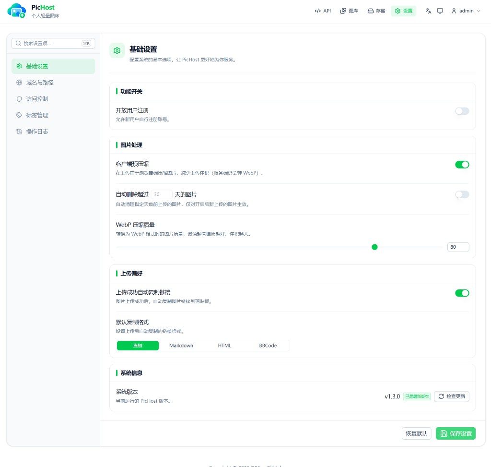

<p align="center">
  
</p>

<h1 align="center">PicHost</h1>

<p align="center"><strong>自托管图片、视频与文件管理平台</strong></p>

<p align="center">多用户 · WebP 压缩 · HLS 视频 · 文件床 · 标签 · 多存储后端 · 整站备份与迁移</p>

<p align="center">
  <a href="https://github.com/yeomaiyelove-cpu/PicHost/blob/main/package.json"></a>
  
  <a href="https://hub.docker.com/r/yeomaiyelove/pichost"></a>
  
  
  
</p>

<p align="center">
  <a href="#界面预览">预览</a> ·
  <a href="#核心功能">功能</a> ·
  <a href="#部署方式">部署</a> ·
  <a href="#开发与打包">开发与打包</a> ·
  <a href="docs-site/">文档源码</a> ·
  <a href="README.en.md">English</a>
</p>

---

## 项目简介

PicHost 是一个面向 NAS、家庭服务器和小型自托管场景的媒体管理平台，可统一管理图片、视频和普通文件。除上传与直链外，还提供多用户、标签、搜索、多存储后端、HLS 视频处理、整站备份恢复、跨后端迁移以及两站点同步。

首次启动通过 Web 向导创建管理员，也可以直接从 `.phost.tar.gz` 完整备份恢复。

## 界面预览

| 上传 | 图库 |
| :--: | :--: |
|  |  |

| API | 标签管理 |
| :--: | :------: |
|  |  |

| 存储 | 设置 |
| :--: | :--: |
|  |  |

| 首次设置 | 从备份恢复 |
| :--: | :--: |
|  |  |

| 操作日志 |
| :------: |
|  |

## 核心功能

### 图片管理

- 支持拖拽、文件选择和 `Ctrl+V` 粘贴上传，可配置格式、大小、批量数量和频率限制。
- 服务端使用 Sharp 压缩为 WebP，也可保留原图；支持可选的浏览器端 WebP 压缩。
- 图库支持搜索、分页、存储后端/上传来源/标签筛选，以及网格和列表视图。
- 支持查看详情、复制多种链接格式、批量打标和批量删除，并提供媒体数量与来源统计。
- 支持 Referer 防盗链和来源域名白名单。

### 视频库与 HLS

- 独立的视频上传、搜索和管理页面，支持 MP4、M4V、WebM、MOV、MKV、AVI、FLV、WMV、MPG、MPEG 等格式。
- 上传后自动生成视频缩略图，并可根据设置异步转码为 HLS。
- 支持 `copy`、`veryfast`、`medium`、`slow`、`compress` 等转码档位，可限制并发数、CPU 核心数和目标码率。
- 管理转码进度与失败原因，支持删除时同步清理原视频、缩略图、播放列表和 HLS 分片。
- 支持复制原视频、缩略图和 HLS 地址，并可将 HLS 视频重新封装下载为 MP4。

### 文件床

- 独立管理普通文件，提供上传、搜索、分页、标签、批量删除和直链/下载链接。
- 文件床访问策略可在后台配置，文件、图片和视频可分别使用独立域名。

### 多用户与权限

- 管理员与普通用户账号体系，普通用户只能查看和管理自己的媒体。
- 支持滑块、Cloudflare Turnstile 和 Cap 人机验证，可选择开放注册。
- 支持修改资料、修改密码、管理员清空密码和迁移到账号密码登录。
- 每个用户拥有独立标签和自动删除策略，可设置媒体保存天数。
- 提供登录与上传频率限制、全局/个人 API Token 和操作日志。

### 存储与迁移

- 支持本地磁盘、S3 兼容对象存储和 Telegram 频道/群组。
- S3 兼容 R2、COS、OSS、AWS S3 等服务，支持 `proxy` 和 `public` 两种访问方式。
- 可配置多个存储后端、默认后端、启用状态和容量配额。
- 支持在已配置后端之间迁移图片、视频、文件和索引，迁移后可将目标后端设为默认。

### 备份与站点同步

- 创建和恢复完整 `.phost.tar.gz` 站点备份，包含数据库、图片、视频、文件、缩略图、HLS 内容和标签。
- 备份恢复前可预检文件数量、媒体大小、新增与冲突情况，并选择跳过或覆盖冲突。
- 支持大体积备份流式上传，无需将整个压缩包读入内存。
- 未初始化时可在首次设置页直接恢复备份；云存储密钥不会写入备份，恢复后需重新填写。
- 支持两站点双向同步，可推送或拉取全部媒体，也可只同步图片、视频或文件。
- 站点同步支持断点继续、冲突策略和任务进度；目标站点需要预先存在同名用户。

### API 与兼容性

- 提供图片、视频、文件、标签、搜索、批量操作、备份和系统接口。
- 支持全局 Token 和个人 Token，可通过请求头或表单上传。
- 兼容 Twikoo / EasyImage 的 `POST /api/index.php` 上传接口。
- 前端内置 API 文档和调试界面，支持直接生成并复制 `curl` 示例。

## 部署方式

### Docker

```bash
docker run -d \
  --name pichost \
  -p 6892:6892 \
  -v ./data:/data \
  --restart unless-stopped \
  yeomaiyelove/pichost:latest
```

浏览器打开 `http://<主机IP>:6892`，按向导创建管理员即可。数据默认保存在宿主机的 `./data` 目录。

Docker Hub：

- `yeomaiyelove/pichost:latest`
- `yeomaiyelove/pichost:<版本号>`

### Windows

项目提供 Windows x64 一体安装包：

- 内置 Node.js 和 FFmpeg，不依赖目标电脑预装运行环境。
- 首次启动后按 Web 向导完成设置。
- 数据保存在安装目录下的 `data` 子目录。
- 卸载时会询问是否删除数据；选择保留后，数据库、图片、视频和备份不会被删除。

### 飞牛 NAS

飞牛使用独立的 x86 FPK 安装包，FPK 以内置 Docker 镜像方式运行：

1. 在飞牛 Docker 中导入与 FPK 版本对应的镜像包。
2. 确认镜像列表中存在 `yeomaiyelove/pichost:<版本号>`。
3. 安装 FPK，并按向导选择创建管理员或从备份恢复。

FPK 使用本地镜像，不会自动联网拉取 PicHost 镜像。

## 开发与打包

### 本地开发

```bash
npm ci
npm run dev
```

默认开发地址由 Nuxt 输出，首次访问会进入 `/setup`。常用检查命令：

```bash
npm test
npm run typecheck
npm run lint
npm run build
```

### 构建安装产物

```bash
npm run pack:docker
npm run pack:fpk
npm run pack:windows
```

Windows 环境可以一次构建全部产物：

```bash
npm run pack:all
```

输出位置：

- Docker 离线镜像：`dist-docker/`
- 飞牛安装包：`dist-fpk/`
- Windows 安装程序：`dist-windows/release/`

详细环境要求和可覆盖参数见 [打包说明](packaging/README.md)。

## 数据目录

- Docker 默认使用 `/data`，通过 `DATA_DIR` 可覆盖。
- Windows 安装版使用安装目录下的 `data`。
- 本地开发默认使用项目根目录下的 `data`。

数据库文件为 `pichost.db`。建议定期在后台创建整站备份，并将 `.phost.tar.gz` 文件保存到其他磁盘。

## 技术栈

| 层级 | 技术 |
| ---- | ---- |
| 前端 | Nuxt 4 · Nuxt UI 4 · Vue 3 · Tailwind CSS 4 · TypeScript |
| 后端 | Nitro `node-server` · REST API · H3 |
| 数据库 | SQLite |
| 图片处理 | Sharp（WebP 压缩） |
| 视频处理 | FFmpeg · HLS · hls.js |
| 存储 | 本地磁盘 · S3 兼容对象存储 · Telegram |
| 国际化 | @nuxtjs/i18n（简体中文 / English） |
| 测试与文档 | Vitest · ESLint · vue-tsc · VitePress |
| 部署 | Docker · Node.js 22 · Electron（Windows）· 飞牛 FPK |

## License

[GPL-3.0](LICENSE)
